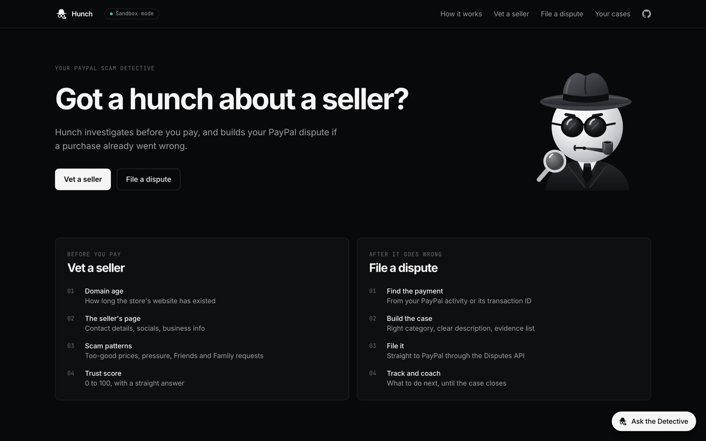
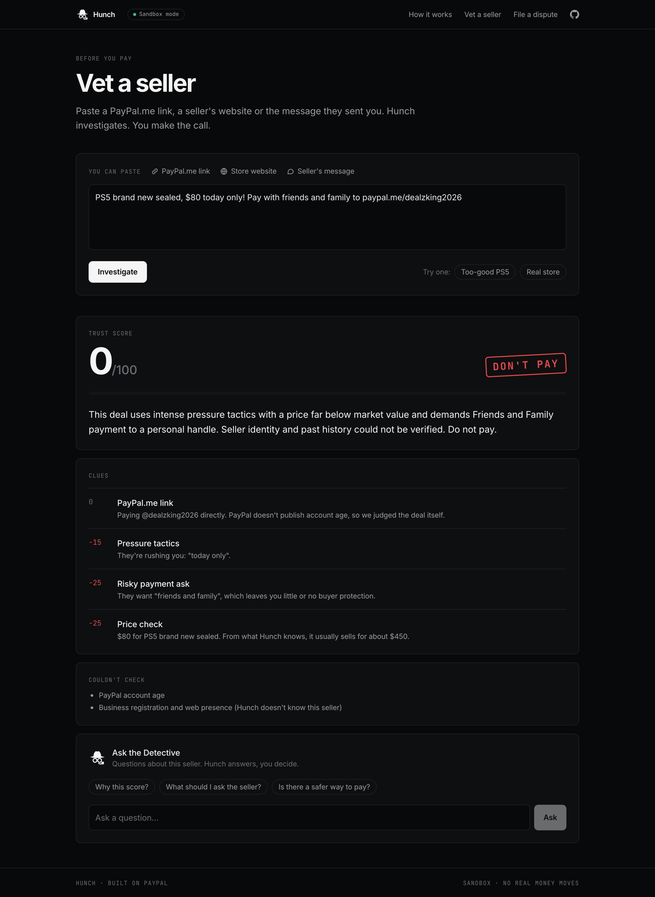
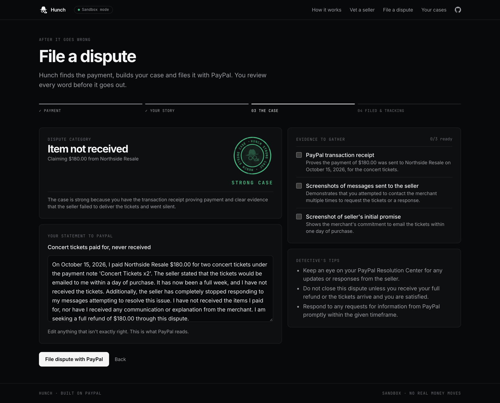
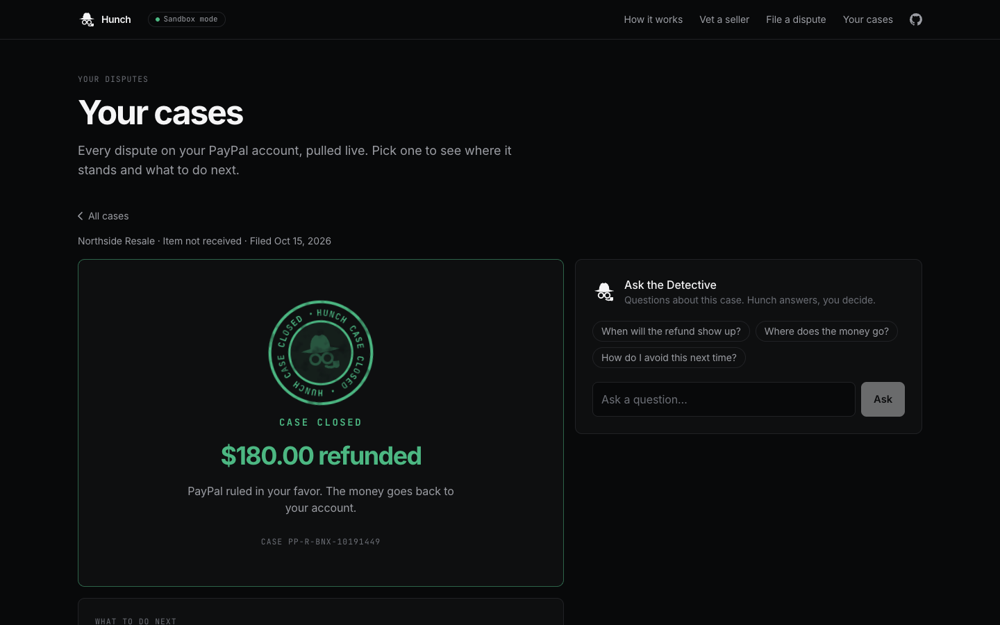
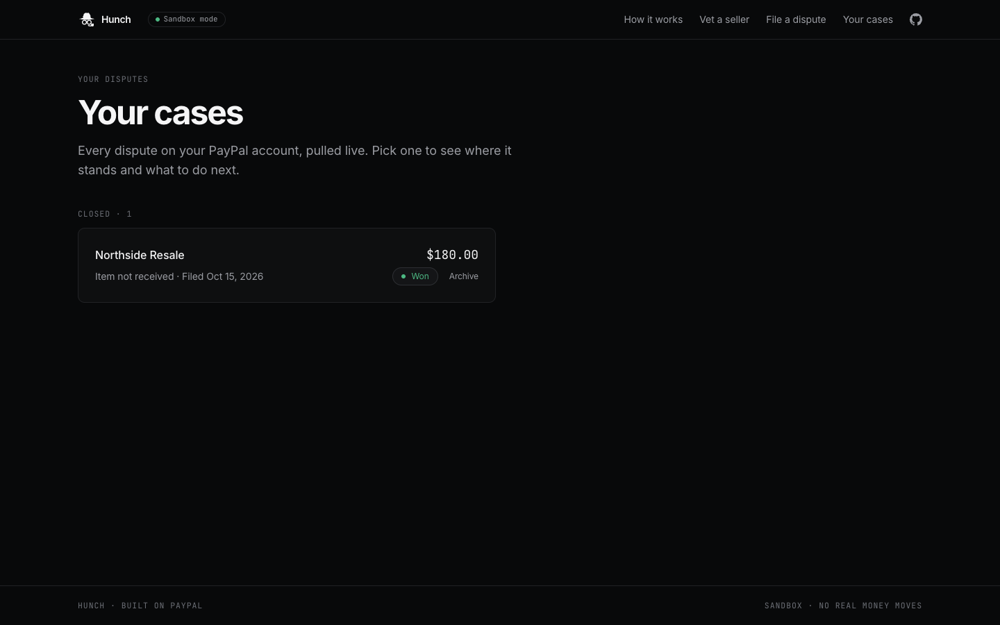

# Hunch

**Your PayPal scam detective.** Check a seller before you pay, and if a purchase goes wrong, Hunch builds and files your PayPal dispute so you can get your money back.

Built for the PayPal AI Hackathon.

**Try it live: [hunch-b3dy.onrender.com](https://hunch-b3dy.onrender.com)**
(It runs on a free server that sleeps when idle, so the first load can take up to a minute.)



## Two modes, one mission

### 🔍 Before you pay: Vet a seller
Paste a seller link, a PayPal.me link, or the payment request itself. Hunch investigates:

- **Domain age** from public RDAP records (a store that's 4 days old is a red flag)
- **The seller's page**: HTTPS, contact details, social links, business info
- **Scam patterns**: too-good-to-be-true prices, pressure tactics, and risky payment requests like Friends and Family, gift cards, or crypto
- **An AI read** on whether the business is known and what the item normally costs

You get a 0–100 trust score, a Hunch seal with the verdict (Looks legit, Be careful or Don't pay), and a plain-language explanation of every clue, plus a list of anything Hunch couldn't check.



### 🛡️ After it goes wrong: File a dispute
Describe what happened in your own words. Hunch:

1. Finds the payment in your PayPal activity, or takes the transaction ID
2. Picks the right PayPal dispute category
3. Writes a calm, factual case description you can edit
4. Lists exactly what evidence to attach and why it helps
5. Files the dispute through PayPal's Disputes API
6. Tracks the case and coaches you on what to do next, until it's closed

| Your case, ready to file | Tracked until it's closed |
|---|---|
|  |  |

### 📁 Your cases
Every dispute on the account in one place, pulled live from PayPal. Each case shows where it stands and how long it's been there ("Waiting on seller · 3h"). Click one to open its tracker. Cases filed on your computer show first, and you can archive the ones you're done with.



### 🕵️ Ask the Detective
A Q&A box on every page. Ask about a seller, your case, or PayPal scams in general, and Hunch answers with the context of what you're looking at. It sticks to buying, selling, payments and disputes.

## It's a tool, not an agent

Hunch investigates and drafts, but you make the call. Nothing is filed or sent without you pressing the button.

## Try it on the live site

The live site runs on a shared PayPal sandbox buyer account with a few payments to a fake store, Northside Resale.

1. **Vet a seller:** click **Too-good PS5** under the box, then **Investigate**.
2. **File a dispute:** pick a Northside Resale payment. Payments that are grayed out already have a case, since PayPal allows one dispute per payment.
3. Tell Hunch what went wrong, click **Build my case**, review it, and click **File dispute with PayPal**.
4. On the tracker, click **Demo: simulate PayPal's decision**. The sandbox takes a few minutes, so click **Refresh** until the case closes in your favor.
5. Open **Your cases** to see it with the rest.

## Tools

**AI: Google Gemini** (free tier, `gemini-3.5-flash`, falling back to `gemini-3.5-flash-lite` and `gemini-3-flash-preview` if a model is busy). Hunch uses it to:

- Judge a seller from the clues it gathered and estimate what the item normally costs
- Pick the dispute category, write the case statement, list the evidence to gather, and rate how strong the case is
- Coach you on what to do next at each stage of a case
- Answer questions in Ask the Detective

Hunch's own checks (domain age, HTTPS, scam patterns, PayPal data) run first, and Gemini works from what they found. Nothing is filed until you click the button.

| Piece | What it does |
|---|---|
| **Next.js** (App Router) + **Tailwind CSS** | The app and its API routes |
| **Google Gemini** | Scam verdicts, dispute case writing, next-step coaching, and Ask the Detective |
| **PayPal Disputes API** | Files disputes, lists every case on the account, reads case status, and tracks outcomes |
| **PayPal Transaction Search API** | Lists recent payments to dispute |
| **RDAP** | Looks up how long a website's domain has existed |

Everything runs against the **PayPal sandbox**, so no real money moves.

## Run it locally

You need Node.js 20+, a free [Gemini API key](https://aistudio.google.com), and a [PayPal developer](https://developer.paypal.com) account.

```bash
git clone https://github.com/vhrcam/hunch.git
cd hunch
npm install
cp .env.example .env.local
```

Fill in `.env.local`:

| Variable | Where it comes from |
|---|---|
| `GEMINI_API_KEY` | Google AI Studio → Get API key |
| `PAYPAL_CLIENT_ID` / `PAYPAL_CLIENT_SECRET` | A sandbox REST app for the buyer's account, with **Transaction search** enabled |
| `SELLER_PAYPAL_CLIENT_ID` / `SELLER_PAYPAL_CLIENT_SECRET` | A second sandbox app for the seller's account, used only by the demo's "simulate PayPal's decision" button |
| `SELLER_PAYPAL_EMAIL` | Optional. The seller account's sandbox email. Hunch then only shows payments and cases for that seller, since only its cases can be simulated |
| `HIDE_BEFORE` | Optional. A date like `2026-10-15T03:10:00Z`. Payments and cases from before it are hidden, for a clean start before a demo |

Then start it:

```bash
npm run dev
```

Open [http://localhost:3000](http://localhost:3000).

## Trying a dispute in the sandbox

1. On [sandbox.paypal.com](https://www.sandbox.paypal.com), log in as the buyer's sandbox account and send a payment to the seller's sandbox account as **paying for an item or service**.
2. In Hunch, go to **File a dispute**, pick the payment (or enter its transaction ID), and describe what happened.
3. Review the case and file it.
4. Use **Demo: simulate PayPal's decision** to play out the seller's side. PayPal's sandbox takes a few minutes per step, so use **Refresh** until the case closes.

Each payment can only be disputed once. New payments can take up to 3 hours to show up in PayPal's Transaction Search, so use **Enter it yourself** with the transaction ID in the meantime.

## License

[MIT](LICENSE)
